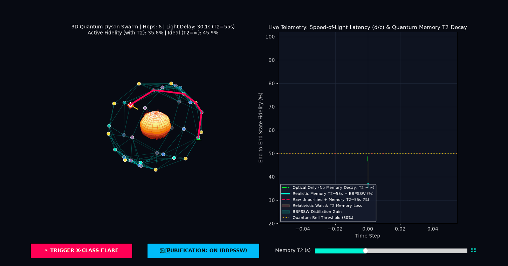
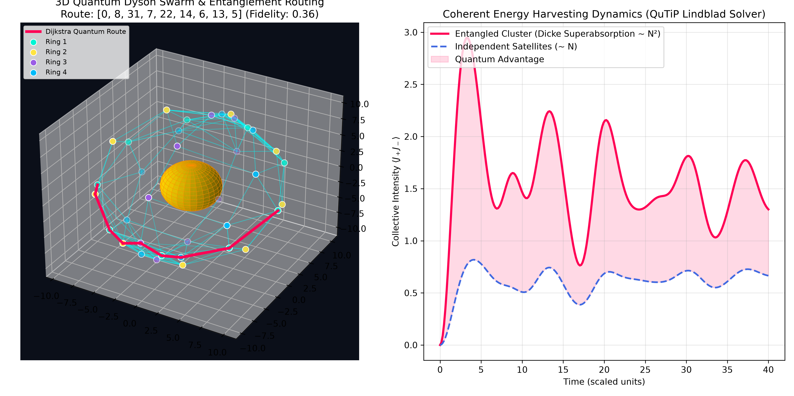

# 🌌 3D Quantum Dyson Swarm & Relativistic Space-Weather Entanglement Routing

[](https://github.com/sc4nd1/quantum-dyson-swarm-3d/actions)


System-level **3D Digital Twin of a Solar Walker Megaconstellation (Dyson Swarm)** featuring **free-space optical quantum entanglement routing**, **relativistic speed-of-light ($d/c$) memory $T_2$ decoherence**, **BBPSSW Werner-state distillation**, **autonomous solar-sail coronal mass ejection (CME) evasion**, and **laser-mediated collective Dicke energy harvesting** solved via the Lindblad Master Equation in **QuTiP**.

---

## 🎥 Live Real-Time Simulation (X-Class Solar Flare Avoidance & $T_2$ Memory Decay)



*Interactive dashboard featuring real-time X-Class Solar Flare triggering, BBPSSW purification toggling, and a live `Memory T2 (s)` coherence slider.*

---

## 🔬 Core Physical & Mathematical Models

### 1. Relativistic Quantum Dijkstra Routing & Werner State Swapping
Each free-space optical link $(u, v)$ not occulted by the solar photosphere ($d_{\perp,\odot} > R_\odot$) is modeled as a depolarizing **Werner channel**:

$$\rho_{uv}(W_{uv}) = W_{uv} \vert{}\Psi^-\rangle\langle\Psi^-\vert{} + \frac{1 - W_{uv}}{4} I_4, \qquad W_{uv} = \frac{4\mathcal{F}_{uv} - 1}{3}$$

When a **Solar Flare / CME** erupts along direction $\hat{\mathbf{u}}_{\text{CME}}(t)$, plasma scattering exponentially attenuates the optical link fidelity $\mathcal{F}_{uv}(t)$. Across a multi-hop repeater chain $\mathcal{P}$ of $M$ links, the end-to-end Werner parameter accounts for both **Bell-State Measurement (BSM) entanglement swapping** and **on-board quantum memory $T_2$ dephasing** during the relativistic classical handshake time $t_{\text{wait}}$:

$$W_{\text{e2e}}(T_2) = \left( \prod_{(u,v) \in \mathcal{P}} W_{uv}^{\text{eff}} \right) \cdot \exp\left( - \frac{t_{\text{wait}}}{T_2} \right), \qquad t_{\text{wait}} = \alpha_{\text{pur}} \sum_{(u,v) \in \mathcal{P}} \frac{d_{uv}}{c} + (M - 1)\, t_{\text{swap}}$$

The routing engine dynamically minimizes the exact additive composite cost via **Dijkstra's algorithm**:

$$w_{uv} = -\ln\left(W_{uv}^{\text{eff}}\right) + \frac{d_{uv}/c + t_{\text{swap}}}{T_2}$$

This creates a realistic hardware trade-off: **high-$T_2$ quantum memories** favor multi-hop short optical links, whereas **low-$T_2$ memories** force the router to select fewer, longer hops to beat relativistic propagation latency.

### 2. BBPSSW Entanglement Purification Protocol
To prevent multi-hop fidelity $\mathcal{F}_{\text{e2e}} = (1 + 3 W_{\text{e2e}})/4$ from collapsing below the **50% Quantum Bell Threshold** ($\mathcal{F} \le 0.5$, where states become separable), each link supports nested **BBPSSW entanglement distillation** (Bennett *et al.*, *Phys. Rev. Lett.* 76, 722) via bilateral `CNOT` gates and projective measurements:

$$\mathcal{F}' = \frac{\mathcal{F}^2 + \frac{1}{9}(1-\mathcal{F})^2}{\mathcal{F}^2 + \frac{2}{3}\mathcal{F}(1-\mathcal{F}) + \frac{5}{9}(1-\mathcal{F})^2} \quad \text{for } \mathcal{F} > 0.5$$

### 3. Autonomous Solar-Sail CME Evasion & Station-Keeping
Satellites intersecting the expanding CME plasma cone execute an autonomous radiation-pressure evasive maneuver ($\Delta\mathbf{r}_i$) coupled with a **Proportional-Derivative (PD) orbital station-keeping controller** ($\mathbf{F}_{\text{PD}} = -k_p \Delta\mathbf{r}_i - k_d \Delta\mathbf{v}_i$) to smoothly return to nominal Keplerian Walker formation after the storm subsides.

### 4. Laser-Mediated Collective Dicke Harvesting (`QuTiP` Lindblad Solver)
Local 5-satellite sub-clusters coupled via coherent optical cavity links (`src/quantum_dynamics.py`) are simulated under open-system Lindblad dissipation:

$$\dot{\rho} = -i[H_{\text{cluster}}, \rho] + \sum_{i=1}^{N} \gamma_{\text{loss}} \mathcal{D}[\sigma_-^{(i)}]\rho, \qquad H_{\text{cluster}} = \frac{\omega_{\odot}}{2}\sum_{i=1}^N \sigma_x^{(i)} + \sum_{i < j} J_{\text{link}}\left(\sigma_+^{(i)}\sigma_-^{(j)} + \text{h.c.}\right)$$

Demonstrating superradiant collective energy transfer scaling $\langle J_+ J_- \rangle \propto \mathcal{O}(N^2)$ against incoherent classical satellites $\mathcal{O}(N)$:



---

## ⚖️ Physical Assumptions & Engineering Trade-offs

To maintain real-time interactive frame rates (30–60 FPS) while preserving physical rigor, this Digital Twin adopts the following explicit modeling choices:

1. **Spatial & Relativistic Scaling:** 1 simulation length unit corresponds to $R_\odot / 3.2 \approx 2.17 \times 10^5\text{ km}$. At orbital radius $R \approx 3.3\,R_\odot$, inter-satellite link distances ($1.5\text{–}3.5 \times 10^6\text{ km}$) yield genuine speed-of-light propagation delays of **$5\text{–}12\text{ s}$ per hop**, compatible with long-lived nuclear-spin or trapped-ion quantum memories ($T_2 \in [10, 150]\text{ s}$).
2. **Coupled-Cavity Collective Regime:** Since free-space Dicke superabsorption requires sub-wavelength emitter spacing ($d \ll \lambda$), the collective Hamiltonian $H_{\text{cluster}}$ represents **cavity/waveguide-mediated dipole-dipole coupling** across phase-locked optical inter-satellite links rather than bare vacuum superradiance.
3. **Deterministic BBPSSW Envelope:** Telemetry plots evaluate the analytical expected fidelity after post-selection with a $1.35\times$ classical handshake latency multiplier, abstracting away stochastic trial-and-error throughput penalties.
4. **Accelerated Solar-Sail Kinematics:** Real solar-sail characteristic accelerations ($\sim \text{mm/s}^2$) require hours of advance CME warning; evasive thrust timescales are accelerated in the 3D viewport for real-time visualization.

---

## 📂 Repository Architecture

```text
quantum-dyson-swarm-3d/
├── .github/workflows/
│   └── ci.yml                  # Automated GitHub Actions CI running pytest on push
├── src/
│   ├── orbital_swarm.py        # 3D Walker geometry, solar occultation, d/c latency & T2 Dijkstra
│   └── quantum_dynamics.py     # QuTiP 5+ Lindblad master equation solver for coupled clusters
├── scripts/
│   ├── run_simulation.py       # Static 3D constellation + QuTiP collective harvesting plot
│   ├── run_realtime_flare.py   # Live interactive 3D dashboard (Flare button, BBPSSW toggle, T2 slider)
│   └── export_gif.py           # Headless Pillow renderer generating figures/live_dyson_swarm.gif
├── tests/
│   └── test_swarm.py           # 4 automated physics, geometry & T2 decoherence unit tests
└── figures/                    # High-resolution static benchmarks and animated GIFs

---

## 🚀 Quickstart & Testing

```bash
# 1. Create an isolated Python 3.12 environment and install dependencies
uv venv --python cpython-3.12
uv pip install -r requirements.txt

# 2. Run the automated Physics, Relativistic Latency & Geometry Test Suite
.\.venv\Scripts\python.exe -m pytest tests/test_swarm.py -v

# 3. Launch the Interactive Real-Time 3D Simulator
.\.venv\Scripts\python.exe scripts/run_realtime_flare.py

```